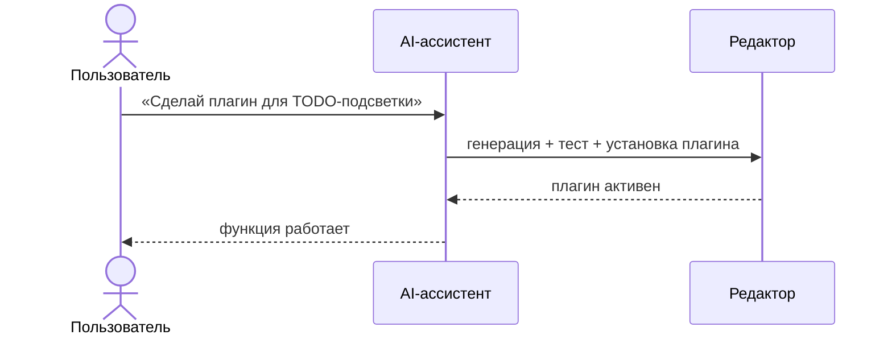

<picture>
  <source media="(prefers-color-scheme: dark)" srcset="crates/app/public/penal_text.svg">
  
</picture>

Markdown-редактор для Windows (10/11) с расширяемостью на лету: встроенный AI напишет, протестирует и подключит плагин без пересборки и перезапуска.


## Как работает AI



## Установка

**Через установщик:** [релизы](https://github.com/Demonss11/darmark/releases) — на Windows 10 установщик подтянет WebView2.

**Из исходников** (Rust 1.99, Node 24):

```bash
git clone https://github.com/Demonss11/darmark.git
cd darmark/crates/app
npm install
npx tauri dev     # dev-режим
npx tauri build   # NSIS-установщик
```

## Документация

- [API плагинов](docs/PLUGIN_API.md)
- [Руководство по плагинам](docs/PLUGIN_GUIDE.md)

## Лицензия

MIT