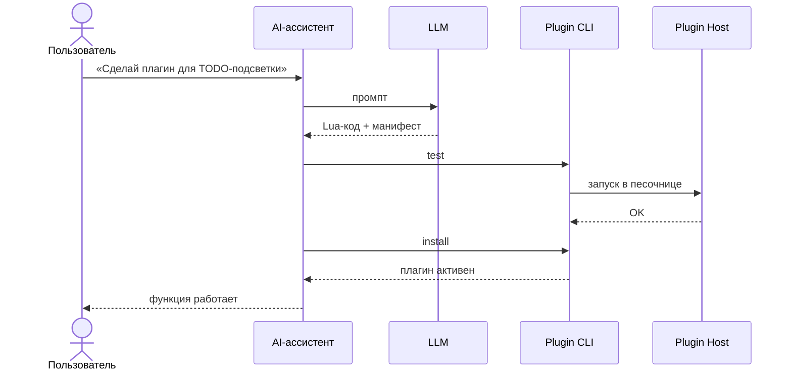

<picture>
  <source media="(prefers-color-scheme: dark)" srcset="crates/app/public/penal_text.svg">
  
</picture>

Markdown-редактор для Windows (10/11), который расширяет себя сам.

Нужна новая функция? Встроенный AI напишет, протестирует и подключит плагин к редактору. Без пересборки, без перезапуска, без ручной возни.


## Что внутри

- **Ядро на Rust** — рендеринг GFM, санитизация HTML и всё, что касается Markdown
- **Изолированные плагины** — Lua в отдельном процессе
- **AI-ассистент** — чат с агентом, который понимает как работать с плагинами программы.

## Как работает AI



## Установка

**Через установщик:** [релизы](https://github.com/Demonss11/darmark/releases)

- **Windows 11** — быстро, WebView2 уже предустановлен
- **Windows 10** — дольше: установщик подтянет WebView2

**Из исходников** (Rust 1.99, Node 24, Lua 5.5):

```bash
git clone https://github.com/Demonss11/darmark.git
cd darmark/crates/app
npm install
npx tauri dev     # dev-режим
npx tauri build   # NSIS-установщик в target/release/bundle/nsis/
```

## Документация

- [API плагинов](docs/PLUGIN_API.md)
- [Руководство по плагинам](docs/PLUGIN_GUIDE.md)

## Лицензия

MIT