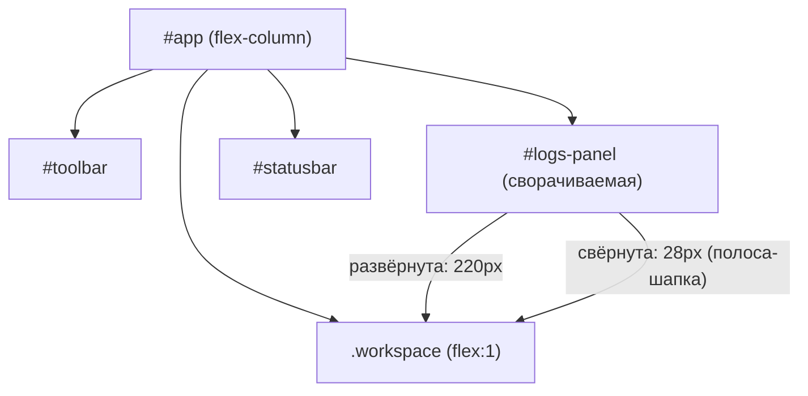

# ADR-0029. Журнал: сворачивающаяся панель-консоль над статусбаром (исключение из паттерна дровера)

- **Статус:** **Принят** (дополнен ADR-0030: док расширен до двух режимов «Журнал»/«AI-ассистент»)
- **Дата:** 11.10.2026
- **Основание:** задача S11 стабилизации; упрощённый прототип
  `ideas/front_idea-s11-log-panel.html` (редакция 2); `docs/adr/0024-plugin-drawer-placement.md`;
  `docs/DESIGN_DOC.md` §5, §9, §13.2
- **Связанные:** `docs/DESIGN_DOC.md` §5.5 (модульная карта), §13.2 (замороженные контракты),
  §16 (реестр ADR); `docs/adr/0024-plugin-drawer-placement.md` (правый дровер плагинов —
  журнал является **исключением**); `crates/app/src/logPanel.ts` (новый модуль),
  `crates/app/src/shell.ts`, `crates/app/index.html`

---

## 1. Контекст

### 1.1. Проблема

После ADR-0024 управление плагинами переехало в правый модальный дровер; журнал остался
только точкой входа в статусбаре (`#sb-logs` + `#log-badge`), полноценная панель журнала
отложена (H3). S11 наполняет слот `#sb-logs`: ошибки плагинов, карантины и действия с
документами происходят незаметно, причины отказов не диагностируются без внешних инструментов.

### 1.2. Ранее отклонённое решение

Редакция 1 прототипа (`ideas/front_idea-s11-log-panel.html`) проектировала журнал как **правый
немодальный дровер 440px** — в стиле дровера плагинов (ADR-0024). Это решение отменено:

- правый дровер конкурирует с дровером плагинов за тот же экранный край;
- журнал — **не модальный**: он нужен фоном, пока работает плагин, и не должен перекрывать
  редактор/превью или требовать закрытия;
- правый дровер не даёт **широкой ленты** (440px мало для сообщений + времени + деталей);
- in-layout панель **сжимает** рабочую область, а не перекрывает её — пользователь всегда видит
  и редактор, и журнал.

### 1.3. Ограничения

- **§13.2 замороженные контракты:** `#sb-logs`, `#log-badge`, `#editor`, `#preview`,
  `#statusbar` — не трогаем.
- **§5.5 модульная карта:** добавляется `logPanel.ts`.
- **§9 события:** существующие + новые Rust-события (аддитивно, мажор `HOST_API_VERSION` не
  поднимаем — ADR-0027 §2.4).
- **Best-effort observability:** потеря записей не критична (не audit log), рендер — только
  `textContent` (CSP/XSS).

---

## 2. Решение

**Журнал — сворачивающаяся панель-консоль на всю ширину, внутри layout, между рабочей
областью и `#statusbar`.** При раскрытии рабочая область сжимается (flex-раскладка), контент
не перекрывается. Это **исключение** из паттерна дровера (ADR-0024): журнал — не дровер,
не модалка, не overlay.

### 2.1. Схема размещения

### 2.2. Зафиксированные решения

| # | Вопрос | Решение |
|---|--------|---------|
| 1 | Паттерн | **In-layout bottom panel** (не дровер, не модалка, не overlay) |
| 2 | Размещение | Между `.workspace` и `#statusbar`, на всю ширину |
| 3 | Раскрытие | **Сжимает** рабочую область (flex), не перекрывает контент |
| 4 | Высоты | Развёрнута `--h-logs: 220px`; свёрнута `--h-logs-bar: 28px`; скрыта — `hidden` |
| 5 | Resize | Drag-handle `#logs-resize` сверху, кламп 28–520px |
| 6 | Триггер | Клик `#sb-logs` (получает `aria-expanded` + `.active`), шеврон `#logs-collapse`, Esc при фокусе в панели |
| 7 | Взаимоисключение | Не требуется (панель не перекрывает контент; дровер плагинов и палитра — модальны, но не конфликтуют) |
| 8 | Замороженные id | `#sb-logs`, `#log-badge`, `#editor`, `#preview`, `#statusbar` — сохраняются |
| 9 | Новые id | `#logs-panel`, `#logs-resize`, `#logs-collapse`, `#logs-list`, `#logs-clear` |
| 10 | Модуль | `crates/app/src/logPanel.ts` — буфер + подписка + рендер |
| 11 | Модель данных | `LogEntry { id, timestamp, level, category, message, detail? }` |
| 12 | Ring buffer | 200 записей (FIFO), перерисовка по `requestAnimationFrame` |
| 13 | События | Push (Rust `app.emit` → TS `listen`), pull при открытии не нужен |
| 14 | Бейдж | `#log-badge` — счётчик непрочитанных, цвет по уровню, сброс при разворачивании |
| 15 | Фильтр | Две кнопки: «Все» / «Ошибки» (`level = warn/error`) |
| 16 | Доступность | `role="region"`, `role="log"`, `aria-live="polite"`, `aria-pressed` на фильтрах |

### 2.3. Интеграция

- `main.ts` — создать экземпляр `logPanel`, передать в `createShell`.
- `shell.ts` — заменить заглушку «Журнал — скоро» на `logPanel.toggle()`.
- `index.html` — разметка панели между `.workspace` и `#statusbar`.
- `style.css` — стили панели (токены, записи, фильтр, бейдж, drag-handle).

### 2.4. События (аддитивно)

| Событие | Эмиттер | Зачем |
|---------|---------|-------|
| `plugin-status-changed` | `host.rs` | «плагин X: active → failed», «карантин (N=3)» |
| `document-event` | `lib.rs` | «Открыт файл …», «Сохранён …» |
| `log-entry` | `services.rs` (`LogSink`) | `host.log` из Lua + ошибки IPC |

Существующие события (`plugin-message`, `document-updated`, `plugins-changed`,
`plugin-views-changed`) — переиспользуем. `plugins-changed` оставляем с пустым payload
(обратная совместимость, ADR-0027 §2.4).

---

## 3. Последствия

**Положительные:**
- **Best-effort observability:** ошибки плагинов, карантины и действия с документами видны
  без внешних инструментов.
- **In-layout:** журнал не перекрывает контент; пользователь видит и редактор, и журнал.
- **Широкая лента:** сообщение + время + детали в одну строку (не 440px, а всю ширину).
- **Переиспользуемый паттерн:** сворачивающаяся панель-консоль пригодится для будущих
  панелей (IDEA-012 мониторинг).
- **Аддитивные события:** мажор `HOST_API_VERSION` не поднимаем (ADR-0027 §2.4).

**Цена / ограничения:**
- **Вертикаль:** панель съедает вертикаль на маленьком экране (митигация: свёртка до 28px,
  resize, дефолт 220px).
- **Новые id:** `#logs-panel`, `#logs-resize`, `#logs-collapse`, `#logs-list`, `#logs-clear` —
  добавляются в §13.2 (аддитивно, не ломают существующие контракты).
- **Модульная карта:** `logPanel.ts` добавляется в §5.5.
- **E2E:** новая фича `logs.feature`, обновление `a11y.feature` и `drawer.feature`.

**Обратимость:** панель можно скрыть, удалив `hidden` по умолчанию; `logPanel.ts` —
самодостаточный модуль, удаляется без изменения других модулей.

---

## 4. Отклонённые альтернативы

- **Правый немодальный дровер 440px (редакция 1 прототипа).** Отклонён: конкурирует с дровером
  плагинов за тот же край; журнал нужен фоном, а не модально; 440px мало для ленты; overlay
  перекрывает контент.
- **Правый модальный дровер (как ADR-0024).** Отклонён: тот же край, что и дровер плагинов;
  модальность не нужна для фоновой наблюдаемости.
- **Модальное окно / диалог.** Отклонён: перекрывает контент, требует закрытия, не даёт
  фоновой наблюдаемости.
- **Только бейдж в статусбаре (без панели).** Отклонён: не даёт истории, причины отказов не
  диагностируются.
- **Полноценная панель журнала (H3).** Отклонено: ADR-0024 §3 — S11 наполняет слот `#sb-logs`,
  а не строит H3-панель; полноценная панель — отдельная задача.

---

## 5. Ссылки

- `docs/DESIGN_DOC.md` §5.5 (модульная карта), §13.2 (замороженные контракты), §16 (реестр ADR).
- `docs/adr/0024-plugin-drawer-placement.md` — правый дровер плагинов; журнал — **исключение**
  (этот ADR).
- `docs/adr/0027-host-api-version-policy.md` — аддитивные события не поднимают мажор.
- `docs/adr/0030-bottom-dock-two-modes.md` — док на два режима («Журнал»/«AI») — расширение этого ADR.
- `ideas/front_idea-s11-log-panel.html` — упрощённый прототип (редакция 2).
- `crates/app/src/logPanel.ts`, `shell.ts`, `main.ts`, `index.html`, `style.css` — точки интеграции.
- `crates/app/src-tauri/src/plugins/host.rs`, `services.rs`, `lib.rs` — эмиттеры событий.
