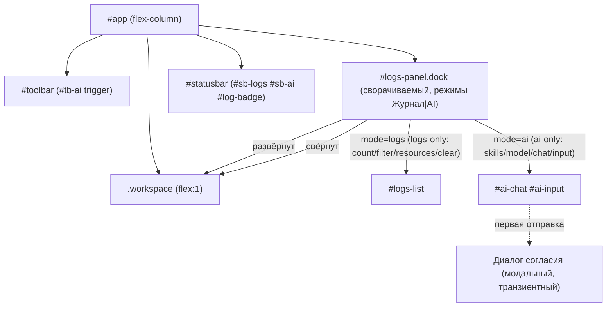

# ADR-0030. Нижний док: «Журнал» и «AI-ассистент» — два режима одной панели (расширение ADR-0029; исключение из ADR-0024)

- **Статус:** **Принят**
- **Дата:** 11.10.2026
- **Основание:** прототип режима AI (редакция 2; удалён после реализации);
  IDEA-013 (ТЗ AI-ассистента, Ф1/Ф2 реализованы); `docs/adr/0029-journal-bottom-panel.md`;
  `docs/adr/0024-plugin-drawer-placement.md`; `docs/DESIGN_DOC.md` §5, §5.5, §13.2
- **Связанные:** `docs/DESIGN_DOC.md` §5 (UI), §5.5 (модульная карта), §13.2 (замороженные
  контракты) (реестр ADR); `docs/adr/0029-journal-bottom-panel.md` (**расширяется**);
  `docs/adr/0024-plugin-drawer-placement.md` (AI-чат — **ещё одно исключение** из паттерна
  дровера); `docs/adr/0007-*`/§11 (санитайзер); `docs/adr/0031-resource-monitoring-source.md`
  (мониторинг ресурсов, номер ADR — 0031); `docs/adr/0032-ai-provider-openai.md`
  (провайдер LLM в MVP: OpenAI-совместимый API, `routerai.ru`)

---

## 1. Контекст

### 1.1. Проблема

IDEA-013 (ТЗ AI-ассистента, Ф1/Ф2 реализованы) проектировала AI-ассистента как **правый модальный дровер 480px**
(по образцу дровера плагинов, ADR-0024). Решение пересмотрено на этапе дизайна: AI-чат —
это **консольный инструмент**, работающий фоном рядом с документом (показать дифф, карточку
плагина, ошибку), а не отдельный экран-модалка. Правый дровер отклонён (см. §4).

### 1.2. Сосуществование с журналом: один док, два режима

Вариантов было три: (а) один док с двумя режимами; (б) два независимых нижних док;
(в) overlay поверх рабочей области. Принят **(а)**:
- второй док (б) съедает вертикаль дважды и дублирует resize/свёртку — оба режима делят один
  слот, одну ручку высоты, одно состояние свёртки;
- overlay (в) конфликтует с инвариантом ADR-0029 §2 («панель сжимает рабочую область, а не
  перекрывает её»).

### 1.3. Ограничения

- **§13.2 замороженные контракты:** контракты ADR-0029 (`#logs-*`) и базовые id
  (`#editor`, `#preview`, `#statusbar`, `#sb-logs`, `#log-badge`) — **не трогаем**.
- **§5.5 модульная карта:** добавляются новые модули для режимов дока и тела AI
  (конкретные имена — в структуре проекта и §5.5).
- **Рендер на Rust-стороне (D7/§11):** ответ LLM не попадает в `innerHTML` минуя
  Rust-санитайзер (ADR-0007).
- **CSP `default-src 'self'`** и **D6 (≤6 МБ):** новых тяжёлых зависимостей не вводим
  (сетевой слой AI и провайдер LLM — **ADR-0032**, вне этого решения).
- **Best-effort:** AI-чат — не audit log; ошибки LLM/сети показываются в чате, не роняют приложение.

---

## 2. Решение

**Один нижний док на два взаимоисключающих режима — «Журнал» и «AI-ассистент» — внутри layout,
между `.workspace` и `#statusbar`.** Док немодальный, сжимает рабочую область (не overlay).
Переключение режима — тихим сегментом в шапке; триггеры `#sb-logs` и `#sb-ai` открывают док в
своём режиме. Это **расширение ADR-0029** (док — та же панель-консоль) и **исключение из
ADR-0024** (AI-чат — не правый дровер).

### 2.1. Схема размещения

### 2.2. Зафиксированные решения

| # | Вопрос | Решение |
|---|--------|---------|
| 1 | Паттерн | **In-layout bottom dock** (не дровер, не модалка, не overlay) |
| 2 | Контейнер | **Переиспользуется существующий `#logs-panel`**; `#bottom-dock` **не вводится** |
| 3 | Режимы | Два **взаимоисключающих** режима: «Журнал» / «AI-ассистент» (radio-tablist) |
| 4 | Раскрытие | **Сжимает** рабочую область (flex), не перекрывает контент |
| 5 | Высоты | Общие токены для режимов; конкретные значения — в `style.css` |
| 6 | Resize | Общий `#logs-resize` сверху, кламп; границы — в `style.css` |
| 7 | Общее состояние | Открыт/свёрнут и высота — **общие** для режимов; смена режима не меняет высоту/свёртку |
| 8 | Триггеры | Открывают док в своём режиме (`#sb-logs`→Журнал, `#sb-ai`/`#tb-ai`/`Ctrl+Shift+A`→AI) |
| 9 | Логика триггера | Скрыт/свёрнут → открыть в своём режиме; открыт в другом → переключить; открыт в том же → свернуть |
| 10 | Esc | Свернуть док; фокус — на триггер **активного** режима (`#sb-logs`/`#sb-ai`) |
| 11 | Взаимоисключение | Только между **режимами** дока; с дровером плагинов и палитрой док не конфликтует (немодальный) |
| 12 | Модальность | Модален **только диалог согласия** на отправку (транзиентный, `dialog.ts`); док — немодальный |
| 13 | Замороженные id | Все контракты ADR-0029 и §13.2 сохраняются |
| 14 | Новые id (аддитивно) | `#sb-ai`, `#tb-ai`, `#ai-*`, `#dock-modes`, `#mode-*` — список в `index.html` |
| 15 | Режимная шапка | Состав зависит от режима (logs-only / ai-only); контракты `#logs-*` не ломаются |
| 16 | Рендер ответа AI | Только HTML, **санитизированный Rust-санитайзером** (D7/§11); MVP допустим на `textContent` |
| 17 | Модули | Новые модули — в §5.5 модульной карты |
| 18 | Взаимодействие с ADR-0029 | Журнал — один из режимов дока; контракты и поведение `#logs-*` сохраняются |
| 19 | События | Переиспользуются существующие (`log-entry`, `document-*`, `plugin-*`); новые события AI — аддитивны (ADR-0027 §2.4) |
| 20 | Доступность | По §13.2; роли `#logs-*` сохраняются; сегмент — `tablist`/`tab`/`aria-selected`; тела — `tabpanel` |

> **Дополнение 11.10.2026 (IDEA-015).** Док получил третье состояние **`hidden`** и явные
> affordances скрытия: кнопка `#logs-close` (×) и **прогрессивный Esc** (`expanded → collapsed →
> hidden`; только при фокусе внутри дока). Режимы: **«Журнал | Мониторинг | AI-ассистент»**
> (мониторинг ресурсов — ADR-0031). Новые id: `#logs-close`, `#sb-mon`, `#mode-mon-btn`,
> `#mon-body`, `#mon-rows`, `#mon-summary`. (Прототип дока использован при проектировании;
> удалён после реализации.)

### 2.3. Диалог согласия

Единственный модальный элемент AI. Транзиентный → переиспользуется `openDialog()` с примитивами
из системы диалогов: `role="dialog"`, `aria-modal="true"`, `inert` на `#app`, focus-trap, возврат
фокуса в чат. Взаимоисключение с дровером плагинов/палитрой обеспечивает система диалогов.

---

## 3. Последствия

**Положительные:**
- **Один слот, два инструмента:** нет дублирования и конкуренции за экранный край.
- **Немодальность:** чат живёт фоном, редактор/превью остаются доступны.
- **Нулевой миграционный риск:** замороженные id и E2E-контракты сохраняются; добавления — аддитивны.
- **Переиспользуемый паттерн:** «док с режимами» пригодится будущим консольным панелям (IDEA-012).

**Цена / ограничения:**
- **Вертикаль:** док съедает высоту на маленьком экране (митигация: свёртка, resize, дефолт
  выше 220px ADR-0029, т.к. чату нужнее).
- **Рендер AI:** требует санитайзера перед `innerHTML` (или `textContent` в MVP) — иначе нарушение
  инварианта D7/§11.
- **E2E:** новая фича `ai-dock.feature` (режим, триггеры, согласие); обновление `a11y.feature`.

**Обратимость:** режим AI можно скрыть (убрать `#sb-ai`/`#tb-ai` из разметки), вернувшись к
журналу как в ADR-0029; модули AI — удаляются без правок `logPanel.ts` и контрактов.

---

## 4. Отклонённые альтернативы

- **Правый модальный дровер 480px** — конкурирует за край с дровером плагинов; модальность
  не нужна чату; 480px мало для диффов/карточек кода.
- **Второй независимый нижний док** — дважды съедает вертикаль, дублирует resize/свёртку.
- **Overlay-чат поверх рабочей области** — противоречит инварианту ADR-0029 («сжимает, а не
  перекрывает»).
- **AI как Тир-2 DomView в панели/табе** — чат глобален и не является представлением документа;
  view-модель привязана к панели/документу.
- **Правый немодальный док.** Отклонён: тот же экранный край, что у дровера плагинов; узкая
  колонка ≤480px неудобна для диффов.
- **Переименовать контейнер в `#bottom-dock`/`#dock-*`.** Отклонён: ломает замороженные
  контракты §13.2/ADR-0029 и E2E; переиспользование `#logs-panel` даёт тот же результат
  без миграции.
- **Полностью независимый AI-модуль ввода-вывода без режима журнала.** Отклонён: дублирует
  слот и ручку высоты (см. §1.2, «второй док»).

---

## 5. Ссылки

- `docs/DESIGN_DOC.md` §5 (UI), §5.5 (модульная карта), §13.2 (замороженные контракты) (реестр ADR).
- `docs/adr/0029-journal-bottom-panel.md` — панель «Журнал» (расширяется этим ADR до дока).
- `docs/adr/0024-plugin-drawer-placement.md` — правый дровер плагинов; AI-чат — **исключение**
  (этот ADR).
- `docs/adr/0027-host-api-version-policy.md` — аддитивные события не поднимают мажор.
- `docs/adr/0007-*`, `DESIGN_DOC` §11 — единая точка санитайзера (рендер ответа AI).
- IDEA-013 — исходная идея AI; ТЗ AI-ассистента (Ф1/Ф2 реализованы) — дровер заменён режимом
  дока; Ф3 (скиллы, MCP, провайдеры) — `tasks/TZ-AI-PHASE3.md`.
- `docs/adr/0031-resource-monitoring-source.md` — мониторинг ресурсов (номер ADR — 0031).
- `docs/adr/0032-ai-provider-openai.md` — провайдер LLM в MVP: OpenAI-совместимый API (`routerai.ru`);
  локальная LLM отложена (сетевой слой AI, согласие, секреты; расширяет этот ADR по части AI-подсистемы).
- Прототип режима AI (редакция 2) — удалён после реализации.
