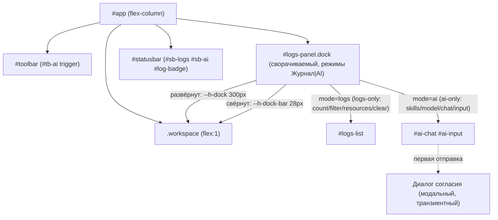

# ADR-0030. Нижний док: «Журнал» и «AI-ассистент» — два режима одной панели (расширение ADR-0029; исключение из ADR-0024)

- **Статус:** **Принят**
- **Дата:** 11.10.2026
- **Основание:** прототип `ideas/front_idea-ai-assistant.html` (редакция 2);
  `tasks/TZ-AI-ASSISTANT.md` (IDEA-013); `docs/adr/0029-journal-bottom-panel.md`;
  `docs/adr/0024-plugin-drawer-placement.md`; `docs/DESIGN_DOC.md` §5, §5.5, §13.2
- **Связанные:** `docs/DESIGN_DOC.md` §5 (UI), §5.5 (модульная карта), §13.2 (замороженные
  контракты), §16 (реестр ADR); `docs/adr/0029-journal-bottom-panel.md` (**расширяется**);
  `docs/adr/0024-plugin-drawer-placement.md` (AI-чат — **ещё одно исключение** из паттерна
  дровера); `docs/adr/0007-*`/§11 (санитайзер); `docs/adr/0031-resource-monitoring-source.md`
  (мониторинг ресурсов, номер ADR — 0031); `docs/adr/0032-ai-provider-openai.md`
  (провайдер LLM в MVP: OpenAI-совместимый API, `routerai.ru`); `crates/app/src/logPanel.ts`,
  `crates/app/src/main.ts`, `crates/app/index.html`, `crates/app/src/style.css`

---

## 1. Контекст

### 1.1. Проблема

IDEA-013/TZ-AI-ASSISTANT проектировала AI-ассистента как **правый модальный дровер 480px**
(по образцу дровера плагинов, ADR-0024). Решение пересмотрено на этапе дизайна: AI-чат —
это **консольный инструмент**, работающий фоном рядом с документом (показать дифф, карточку
плагина, ошибку), а не отдельный экран-модалка. Правый дровер:
- конкурирует за тот же экранный край, что и дровер плагинов (ADR-0024);
- по определению модален (backdrop, `inert` на `#app`), а чату модальность не нужна — он должен
  работать при живом редакторе/превью;
- ширина 480px мала для диффов и карточек кода плагина.

К этому моменту панель «Журнал» (ADR-0029) уже занимает нижний слот над `#statusbar` — ровно
тот тип поверхности, который нужен AI-чату. Обе панели — консольного типа и делят один слот.

### 1.2. Ранее отклонённое решение

**Правый модальный дровер `--w-ai-drawer: 480px`** (редакция 1 идеи; TZ-AI-ASSISTANT §2 п.1,
§3.5, §8.1). Отменено по причинам §1.1. Отдельно отменяется и проектирование AI как
**Тир-2 DomView** через `viewRegistry.ts`/`paneHost.ts` (TZ §3.5): AI-чат — подсистема
**оболочки** (как журнал), а не представление документа; view-модель привязана к панели и
документу, тогда как чат глобален и переживает переключение панелей.

### 1.3. Сосуществование с журналом: один док, два режима

Вариантов было три: (а) один док с двумя режимами; (б) два независимых нижних дока;
(в) overlay поверх рабочей области. Принят **(а)**:
- второй док (б) съедает вертикаль дважды и дублирует resize/свёртку — оба режима делят один
  слот, одну ручку высоты, одно состояние свёртки;
- overlay (в) конфликтует с инвариантом ADR-0029 §2 («панель сжимает рабочую область, а не
  перекрывает её»).

### 1.4. Ограничения

- **§13.2 замороженные контракты:** `#editor`, `#preview`, `#statusbar`, `#sb-logs`,
  `#log-badge`, а также контракты ADR-0029 `#logs-panel`, `#logs-resize`, `#logs-collapse`,
  `#logs-list`, `#logs-clear` — **не трогаем**.
- **§5.5 модульная карта:** добавляются `bottomDock.ts` и `aiPanel.ts`; `logPanel.ts`
  сужает ответственность до тела режима «Журнал».
- **Рендер на Rust-стороне (D7/§11):** ответ LLM не попадает в `innerHTML` минуя Rust-санитайзер.
- **CSP `default-src 'self'`** и **D6 (≤6 МБ):** новых тяжёлых зависимостей не вводим
  (сетевой слой AI и провайдер LLM — **ADR-0032**, вне этого решения).
- **Best-effort:** AI-чат — не audit log; ошибки LLM/сети показываются в чате, не роняют приложение.

---

## 2. Решение

**Один нижний док на два взаимоисключающих режима — «Журнал» и «AI-ассистент» — внутри layout,
между `.workspace` и `#statusbar`.** Док немодальный, сжимает рабочую область (не overlay).
Переключение режима — тихим сегментом в шапке; триггеры `#sb-logs` и `#sb-ai` открывают док в
своём режиме. Это **расширение ADR-0029** (док — та же панель-консоль) и **исключение из
ADR-0024** (AI-чат — не правый дровер).

### 2.1. Схема размещения

### 2.2. Зафиксированные решения

| # | Вопрос | Решение |
|---|--------|---------|
| 1 | Паттерн | **In-layout bottom dock** (не дровер, не модалка, не overlay) |
| 2 | Контейнер | **Переиспользуется существующий `#logs-panel`**; `#bottom-dock` **не вводится** |
| 3 | Режимы | Два **взаимоисключающих** режима: «Журнал» / «AI-ассистент» (radio-tablist) |
| 4 | Раскрытие | **Сжимает** рабочую область (flex), не перекрывает контент |
| 5 | Высоты | Общие токены `--h-dock: 300px` (развёрнут), `--h-dock-bar: 28px` (свёрнут); `--h-logs*` из ADR-0029 заменяются |
| 6 | Resize | Общий `#logs-resize` сверху, кламп **28–520px** (прототипные 560 — опечатка) |
| 7 | Общее состояние | Открыт/свёрнут и высота — **общие** для режимов; смена режима не меняет высоту/свёртку |
| 8 | Триггеры | `#sb-logs`→режим «Журнал», `#sb-ai`→режим «AI», `#tb-ai` (тулбар)→«AI», `Ctrl+Shift+A`→«AI» |
| 9 | Логика триггера | Скрыт/свёрнут → открыть в своём режиме; открыт в другом → переключить; открыт в том же → свернуть |
| 10 | Esc | Свернуть док; фокус — на триггер **активного** режима (`#sb-logs`/`#sb-ai`) |
| 11 | Взаимоисключение | Только между **режимами** дока; с дровером плагинов и палитрой док не конфликтует (немодальный) |
| 12 | Модальность | Модален **только диалог согласия** на отправку (транзиентный, `dialog.ts`); док — немодальный |
| 13 | Замороженные id | `#editor`, `#preview`, `#statusbar`, `#sb-logs`, `#log-badge`, `#logs-panel`, `#logs-resize`, `#logs-collapse`, `#logs-list`, `#logs-clear` — сохраняются |
| 14 | Новые id (аддитивно) | `#sb-ai`, `#tb-ai`, `#ai-dot`, `#dock-modes`, `#mode-logs-btn`, `#mode-ai-btn`, `#ai-mode`, `#ai-skills`, `#ai-chat`, `#ai-input`, `#ai-send`, `#ai-settings`, `#ai-clear`, `#ai-model` |
| 15 | Режимная шапка | logs-only: `#logs-count`, `.logs-filter`, `#logs-resources`, `#logs-clear`; ai-only: `#ai-model`, `#ai-settings`, `#ai-clear`, полоса скиллов |
| 16 | Рендер ответа AI | Только HTML, **санитизированный Rust-санитайзером** (`md-core::sanitize_html`, D7/§11); MVP допустим на `textContent`. Сырой вывод LLM в `innerHTML` не попадает |
| 17 | Модули | `bottomDock.ts` (режим/свёртка/resize/триггеры), `aiPanel.ts` (тело AI), `logPanel.ts` (тело «Журнал») |
| 18 | Взаимодействие с ADR-0029 | Журнал — один из режимов дока; контракты и поведение `#logs-*` сохраняются |
| 19 | События | Переиспользуются существующие (`log-entry`, `document-*`, `plugin-*`); новые события AI — аддитивны, мажор `HOST_API_VERSION` не поднимается (ADR-0027 §2.4) |
| 20 | Доступность | Док `role="region"`; сегмент `role="tablist"` + `role="tab"`/`aria-selected`/`aria-controls`; тела `role="tabpanel"`; `#logs-list` сохраняет `role="log"`; чат `role="log"`/`aria-live="polite"`; на триггерах `aria-expanded` |
| 21 | Нумерация | Этот ADR — **0030**; планировавшийся под 0030 ADR мониторинга ресурсов сдвигается на **0031** |

> **Дополнение 11.10.2026 (IDEA-015).** Док получил третье состояние **`hidden`** и явные
> affordances скрытия: кнопка `#logs-close` (×) и **прогрессивный Esc** (`expanded → collapsed →
> hidden`; только при фокусе внутри дока — после свёртки фокус возвращается на триггер, поэтому
> следующий Esc срабатывает, если фокус снова в доке). Режимы: **«Журнал | Мониторинг | AI-ассистент»**
> (`#mode-mon-btn` — мониторинг ресурсов, ADR-0031; `#mode-ai-btn` — зарезервирован, `aria-disabled`).
> Триггеры: `#sb-logs` / `#sb-mon` (новый). Режим «Мониторинг» переехал из строки в шапке в
> **вкладку** (`#mon-body` → `#logs-resources` → `#mon-rows`); в шапке — тихая сводка `#mon-summary`.
> Новые id: `#logs-close`, `#sb-mon`, `#mode-mon-btn`, `#mon-body`, `#mon-rows`, `#mon-summary`.
> (Прототип дока использован при проектировании; удалён после реализации.)

### 2.3. Интеграция

- `main.ts` — создать `bottomDock` (контейнер `#logs-panel`, режимы, свёртка/resize) и
  передать в него тела `logPanel` (режим «Журнал») и `aiPanel` (режим «AI»).
- `shell.ts` — привязка триггеров: `#sb-logs`/`#sb-ai`/`#tb-ai` → `bottomDock.openMode(…)`.
- `index.html` — расширить существующий `#logs-panel`: добавить сегмент режимов в `.logs-head`
  и тело режима AI; добавить `#sb-ai` в `#statusbar`, `#tb-ai` в тулбар. `#logs-*` не трогать.
- `style.css` — токены `--h-dock`/`--h-dock-bar`, стили сегмента, чата, карточек, режимные
  `.logs-only`/`.ai-only`.

### 2.4. Диалог согласия

Единственный модальный элемент AI. Транзиентный → переиспользуется `openDialog()` (`dialog.ts`):
`role="dialog"`, `aria-modal="true"`, `inert` на `#app`, focus-trap, возврат фокуса в чат.
Взаимоисключение с дровером плагинов/палитрой обеспечивает `dialog.ts` (как и раньше), отдельного
правила не требуется.

---

## 3. Последствия

**Положительные:**
- **Один слот, два инструмента:** журнал и AI делят вертикаль, ручку высоты и свёртку — нет
  дублирования и конкуренции за экранный край.
- **Немодальность:** чат живёт фоном, редактор/превью остаются доступны (правки AI видны сразу).
- **Широкая лента:** диффы и карточки плагинов помещаются (вся ширина, а не 480px).
- **Нулевой миграционный риск:** замороженные id и E2E-контракты (`logs.feature`,
  `a11y.feature`) сохраняются; добавления — аддитивны.
- **Переиспользуемый паттерн:** «док с режимами» пригодится будущим консольным панелям
  (IDEA-012 мониторинг ресурсов ложится режимом/слотом в этот же док).

**Цена / ограничения:**
- **Вертикаль:** док съедает высоту на маленьком экране (митигация: свёртка 28px, resize,
  дефолт 300px — выше 220px ADR-0029, т.к. чату нужнее).
- **Новые модули:** `bottomDock.ts`, `aiPanel.ts` — добавляются в §5.5; `logPanel.ts`
  сужает ответственность до тела «Журнал».
- **Новые id:** `#sb-ai`, `#tb-ai`, `#ai-*`, `#dock-modes`, `#mode-*` — добавляются в §13.2
  (аддитивно, контракты не ломают).
- **Рендер AI:** требует Rust-санитайзера перед `innerHTML` (или `textContent` в MVP) — иначе
  нарушение инварианта D7/§11.
- **Нумерация:** ADR мониторинга ресурсов (ADR-0031) сдвигается с 0030 на **0031**.
- **ТЗ:** `TZ-AI-ASSISTANT` (§2, §3.1, §3.5, §4.2, §8, §11) требует правок (см. §5);
  продуктовые границы мониторинга ресурсов зафиксированы в ADR-0031 (§1.2).
- **E2E:** новая фича `ai-dock.feature` (режим, триггеры, согласие); обновление `a11y.feature`.

**Обратимость:** режим AI можно скрыть (убрать `#sb-ai`/`#tb-ai` из разметки), вернувшись к
журналу как в ADR-0029; `aiPanel.ts`/`bottomDock.ts` — отдельные модули, удаляются без правок
`logPanel.ts` и контрактов.

---

## 4. Отклонённые альтернативы

- **Правый модальный дровер 480px (исходное ТЗ AI §8.1, ред. 1).** Отклонён: конкурирует за
  край с дровером плагинов; модальность не нужна чату; 480px мало для диффов/карточек кода.
- **Второй независимый нижний док (журнал и AI — отдельные панели).** Отклонён: дважды съедает
  вертикаль, дублирует resize/свёртку, конкурирует за тот же слот.
- **Overlay-чат поверх рабочей области.** Отклонён: противоречит инварианту ADR-0029
  («сжимает, а не перекрывает»).
- **AI как Тир-2 DomView в панели/табе (ТЗ §3.5).** Отклонён: чат глобален и не является
  представлением документа; view-модель привязана к панели/документу.
- **Правый немодальный док.** Отклонён: тот же экранный край, что у дровера плагинов; узкая
  колонка ≤480px неудобна для диффов.
- **Переименовать контейнер в `#bottom-dock`/`#dock-*`.** Отклонён: ломает замороженные
  контракты §13.2/ADR-0029 и E2E; переиспользование `#logs-panel` даёт тот же результат
  без миграции.
- **Полностью независимый AI-модуль ввода-вывода без режима журнала.** Отклонён: дублирует
  слот и ручку высоты (см. §1.3, «второй док»).

---

## 5. Ссылки

- `docs/DESIGN_DOC.md` §5 (UI), §5.5 (модульная карта), §13.2 (замороженные контракты),
  §16 (реестр ADR).
- `docs/adr/0029-journal-bottom-panel.md` — панель «Журнал» (расширяется этим ADR до дока).
- `docs/adr/0024-plugin-drawer-placement.md` — правый дровер плагинов; AI-чат — **исключение**
  (этот ADR).
- `docs/adr/0027-host-api-version-policy.md` — аддитивные события не поднимают мажор.
- `docs/adr/0007-*`, `DESIGN_DOC` §11 — единая точка санитайзера (рендер ответа AI).
- `tasks/TZ-AI-ASSISTANT.md` — ТЗ AI (правится: дровер → режим дока).
- `docs/adr/0031-resource-monitoring-source.md` — мониторинг ресурсов (номер ADR — 0031).
- `docs/adr/0032-ai-provider-openai.md` — провайдер LLM в MVP: OpenAI-совместимый API (`routerai.ru`);
  локальная LLM отложена (сетевой слой AI, согласие, секреты; расширяет этот ADR по части AI-подсистемы).
- `ideas/front_idea-ai-assistant.html` — прототип (редакция 2).
- `crates/app/src/logPanel.ts`, `main.ts`, `shell.ts`, `index.html`, `style.css` — точки интеграции.
